# Gráficos

Comparação da bateria LRU com 256 quadros: cenários A e B, 1 e 4 CPUs, FCFS, SJF e Round Robin com quantum 2, 5, 10, 20 e 50. O valor de cada barra está no topo.

## Espera média

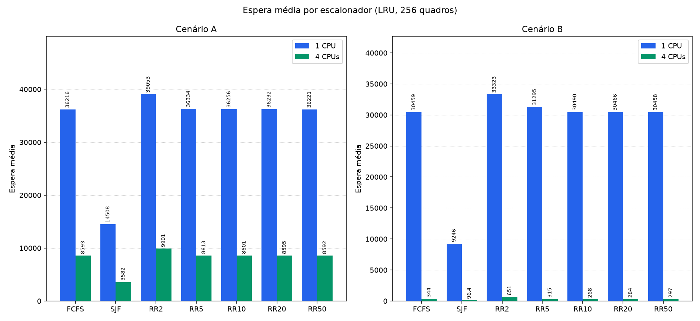

## Espera máxima

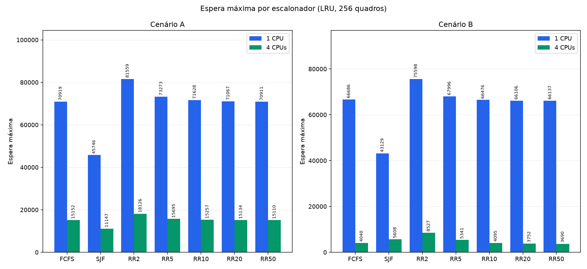

## Turnaround médio

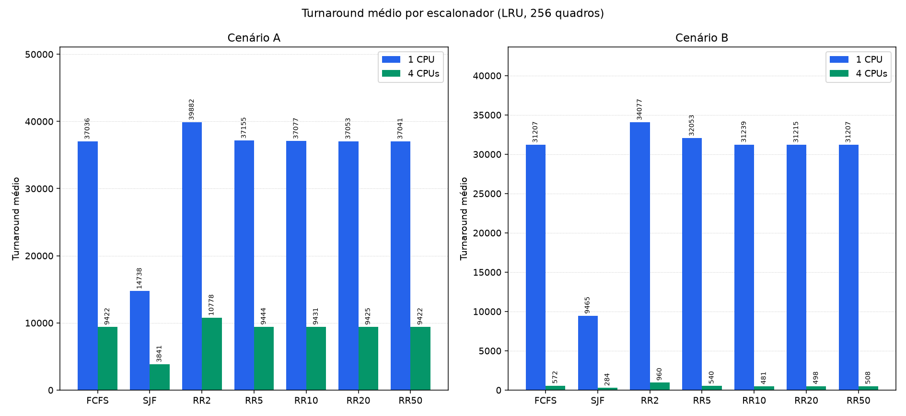

## Resposta média

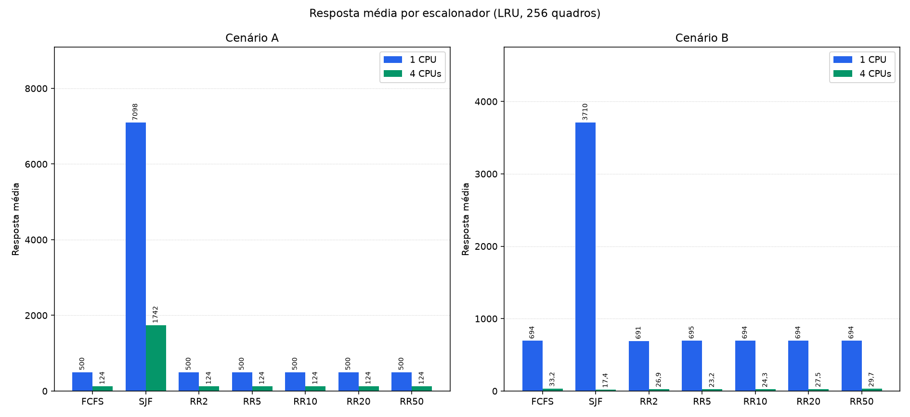

## Makespan

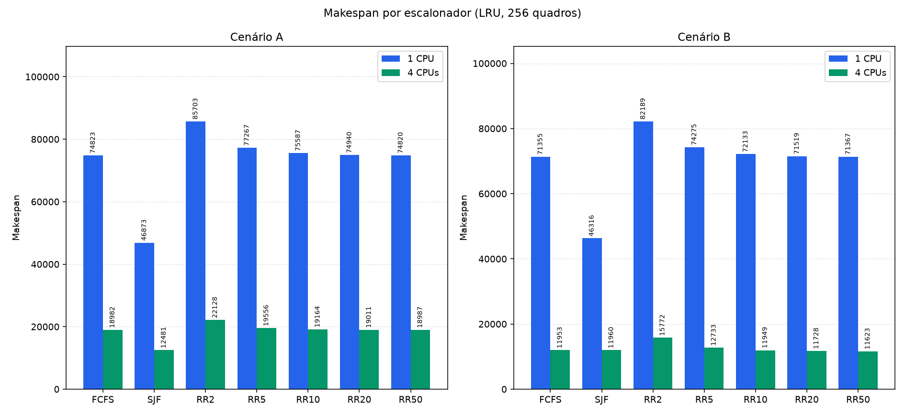

## Page faults

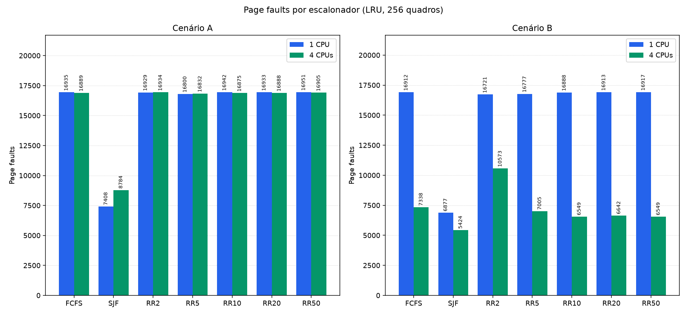

## Trocas de contexto

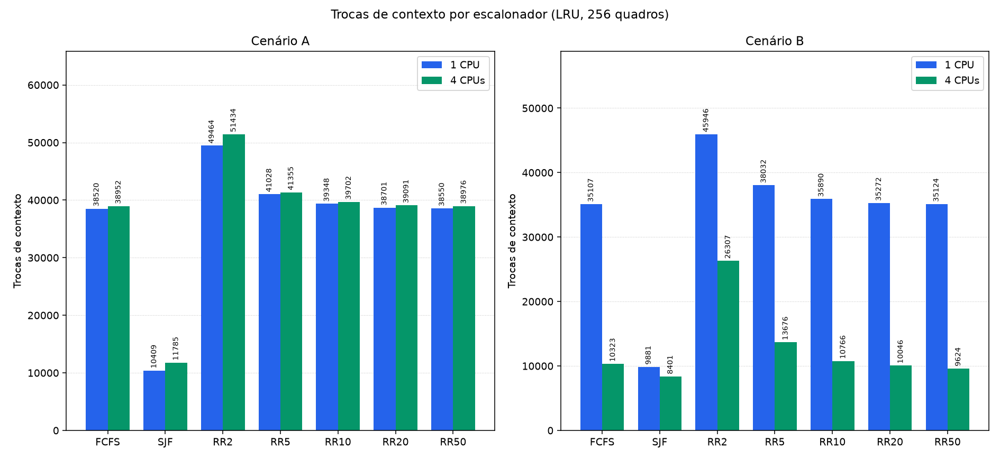

## Taxa de page faults

A taxa está em porcentagem.

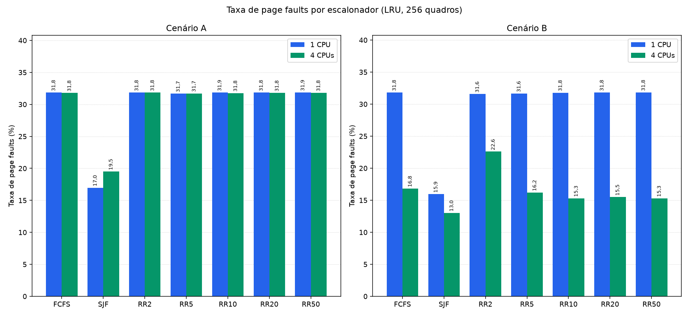

## Efeito do quantum

Espera média, resposta média e trocas de contexto do Round Robin, do quantum 2 ao 50.

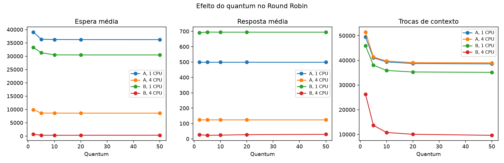

## Speedup

Speedup do makespan de 4 CPUs sobre a rodada irmã de 1 CPU. A linha tracejada marca o ganho ideal, 4.

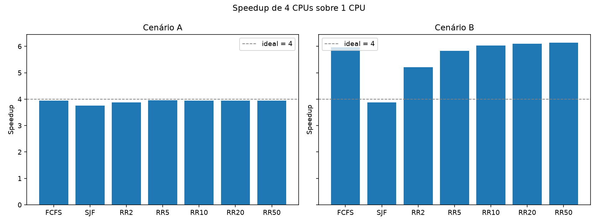

## Gantt, cenário A, FCFS, 1 CPU

Janela de 0 a 200. TROCA é troca de contexto, OCIOSA é CPU sem processo e P seguido do pid é execução útil.

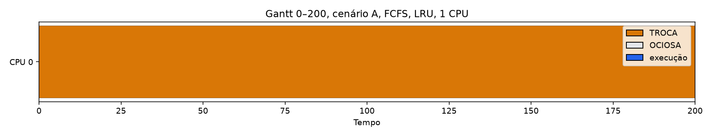

## Gantt, cenário A, FCFS, 4 CPUs

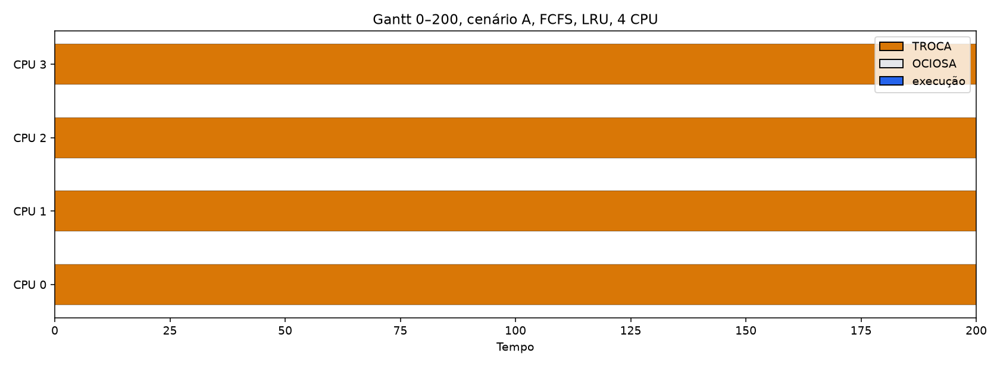
